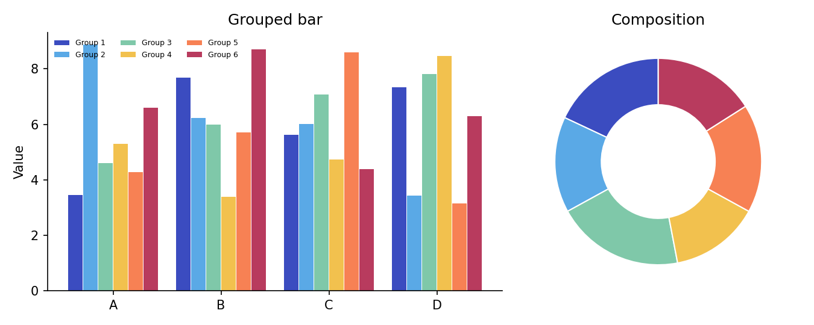
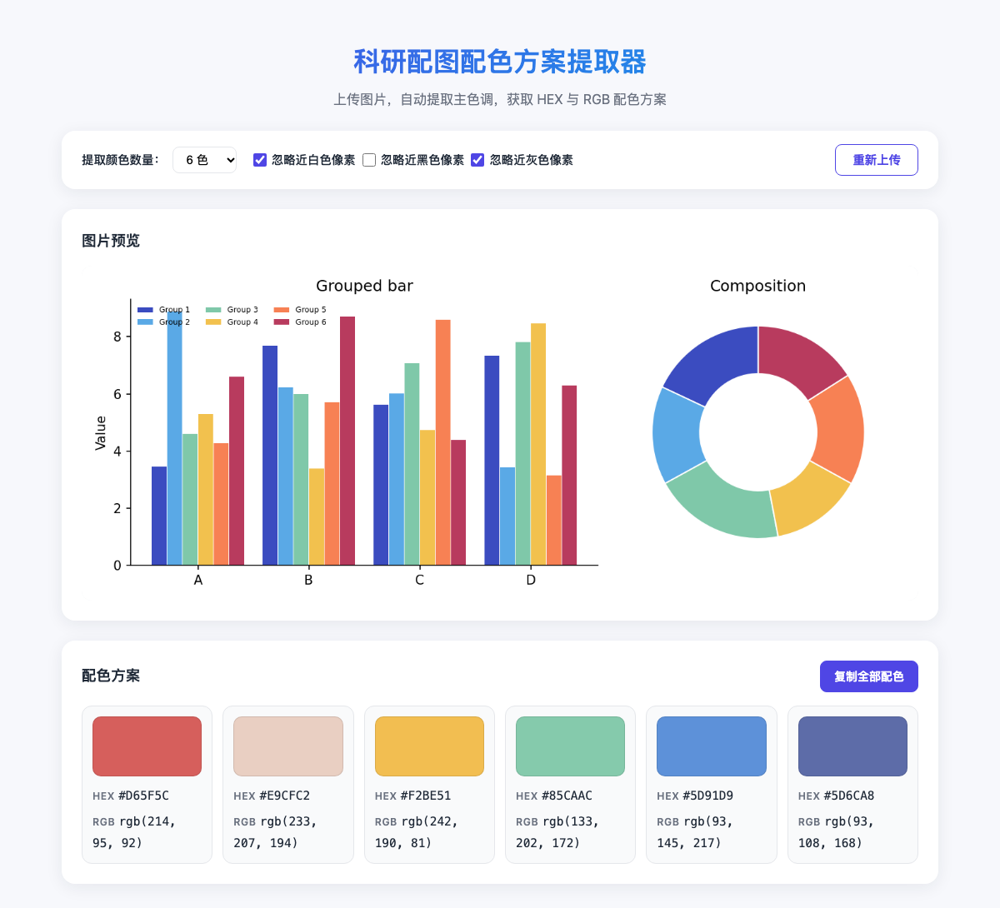

# 科研配图配色方案提取器

从已有科研图片中自动提取主色调，得到可直接用于论文作图的 **HEX / RGB** 配色方案。全部计算在浏览器本地完成，图片不会上传到任何服务器。

**在线使用：<https://wegene38.github.io/color-palette-extractor/>**

---

## 适合做什么

写论文或做汇报时，经常会遇到这些情况：

- 想参考某篇文献插图的配色，但不知道具体色值
- 需要从自己的实验图、示意图、海报里抽出一套协调的颜色
- 希望得到可复制的颜色代码，贴进 Origin、GraphPad、MATLAB、Python、R、PPT 等工具

本工具针对上述场景：上传一张图，就能得到一组按色相整理过的主色。

---

## 功能

| 功能 | 说明 |
| --- | --- |
| 多种导入方式 | 点击选择文件、拖拽到上传区、或 `Ctrl+V` / `Cmd+V` 粘贴剪贴板图片 |
| 可调颜色数量 | 支持提取 4 / 6 / 8 / 10 / 12 种主色，默认 6 色 |
| 背景过滤 | 可选忽略近白色、近黑色、近灰色像素，避免纸面底色、纯黑边框或灰色网格占掉色板名额 |
| 多格式色值 | 每种颜色同时给出 HEX、RGB |
| 横向色板 | 配色方案横向排列在图片预览下方，对照原图查看 |
| 一键复制全部 | 点击「复制全部配色」，按每行 `HEX  rgb(r, g, b)` 的格式复制整套方案 |
| 单色复制 | 点击色块复制 HEX；点击任意色值文字复制对应格式 |
| 本地处理 | 使用 Canvas 读取像素，不经过后端 |

支持常见图片格式：JPG、PNG、WebP 等浏览器能解码的类型。

---

## 快速开始

浏览器打开 **<https://wegene38.github.io/color-palette-extractor/>** 即可使用，无需安装。

1. 点击、拖入或 `Ctrl+V` / `Cmd+V` 粘贴一张科研配图。
2. 在图片预览下方查看横向排列的配色方案；按需调整颜色数量和过滤选项，色板会立刻重算。
3. 点击「复制全部配色」一键复制整套方案，或点击单个色块 / 色值单独复制。

**示例**

输入图片：



提取结果（6 色，勾选忽略近白、近灰像素）：



「复制全部配色」得到的文本形如：

```
#D65F5C  rgb(214, 95, 92)
#E9CFC2  rgb(233, 207, 194)
#F2BE51  rgb(242, 190, 81)
#85CAAC  rgb(133, 202, 172)
#5D91D9  rgb(93, 145, 217)
#5D6CA8  rgb(93, 108, 168)
```

**本地运行（可选）**

克隆仓库后直接用浏览器打开 `index.html`，或启动一个静态服务器：

```bash
python3 -m http.server 8080
```

然后访问 `http://localhost:8080`。

部署到 GitHub Pages 时，仓库根目录已包含空的 `.nojekyll` 文件，避免 Jekyll 处理静态资源。

---

## 使用建议

**提取文献风格配色**

- 裁掉坐标轴标签、大段文字后再提取，主色会更干净。
- 论文白底图建议勾选「忽略近白色像素」。
- 深色背景图建议勾选「忽略近黑色像素」。
- 带灰色网格、坐标轴或阴影底的图，可勾选「忽略近灰色像素」。该选项只过滤低饱和的中间灰（RGB 三通道接近、且不是近白/近黑），彩色主色会保留。

**选择颜色数量**

- 柱状图、分组折线：4～6 色通常够用。
- 热图、多分类气泡图：可试 8～12 色。
- 若结果里出现很接近的重复色，把数量调小再提取。

**把色值用到作图软件**

复制 HEX（如 `#4F46E5`）或 RGB（如 `rgb(79, 70, 229)`），按软件要求粘贴即可。需要整套颜色时用「复制全部配色」，再按需整理成软件所需的列表格式。

---

## 工作原理

核心算法是 **Median Cut（中位切分）色彩量化**，实现见 `script.js` 中的 `quantize()`。

流程概览：

1. **缩小采样**  
   将图片等比缩放到最长边不超过 200 像素，再读取 RGBA 像素。这样大图也能在浏览器里快速处理。

2. **过滤像素**  
   丢弃透明度较低的像素（alpha < 125）。若开启对应选项，再丢弃接近纯白（RGB 均 > 240）、接近纯黑（RGB 均 < 15），或近灰色像素（三通道差值 ≤ 18，且平均亮度介于 20–235）。

3. **中位切分**  
   把所有有效像素放进一个桶。反复选出 RGB 通道跨度最大的桶，按该通道排序后从中位数一切为二，直到桶的数量达到目标色数。

4. **求平均色**  
   每个桶内像素取 RGB 均值，作为该簇的代表色。

5. **排序展示**  
   把颜色转换到 CIELAB 感知色彩空间。白、灰、黑等中性色（色度 < 8）按明度由浅到深排在前面；彩色则以最后一个中性色为起点，用动态规划求经过所有颜色的最短路径，使相邻两色的感知差异之和最小。这样色板会呈现平滑渐变，不会出现深浅来回跳动。

这不是逐像素取色，也不是简单的「出现次数最高的几个 RGB」。它更接近「把画面里的颜色空间切成若干块，每块给一个代表色」，适合从插图里抽出一套可复用的主色。

---

## 项目结构

```
.
├── index.html    # 页面结构与交互控件
├── style.css     # 布局与样式
├── script.js     # 上传、量化、渲染、复制
├── docs/         # README 示例图
├── .nojekyll     # GitHub Pages 使用
└── README.md
```

无构建步骤，无第三方库。

---

## 交互说明

- **点击上传区**：打开系统文件选择器。
- **拖拽图片到上传区**：松开后开始提取。
- **粘贴**：页面处于前台时，从截图或复制的图片直接导入。
- **提取颜色数量**：下拉框变更后立即重新量化。
- **忽略近白 / 近黑 / 近灰**：勾选后立即重新量化。
- **复制全部配色**：将当前色板全部颜色按行复制到剪贴板。
- **重新上传**：清空当前图片与色板，回到初始界面。
- **复制成功**：页面底部会出现短暂提示。

---

## 隐私

图片只在当前浏览器标签页内通过 Canvas 解码和采样。关闭页面后，内存中的像素数据随之释放。本仓库不包含后端、分析脚本或远程请求。

---

## 浏览器

建议使用较新的 Chrome、Edge、Firefox 或 Safari。复制功能优先使用 Clipboard API；在不支持的环境下降级为 `document.execCommand('copy')`。

---

## 局限

- 算法给出的是量化主色，不是吸管精确点选某一像素。
- 文字、网格线、阴影会被计入颜色分布；复杂图建议先裁剪主体区域。
- 渐变图会被切成若干代表色，不会输出连续色带文件。
- 色盲友好性、对比度是否适合期刊印刷，需要在目标软件里再确认。
